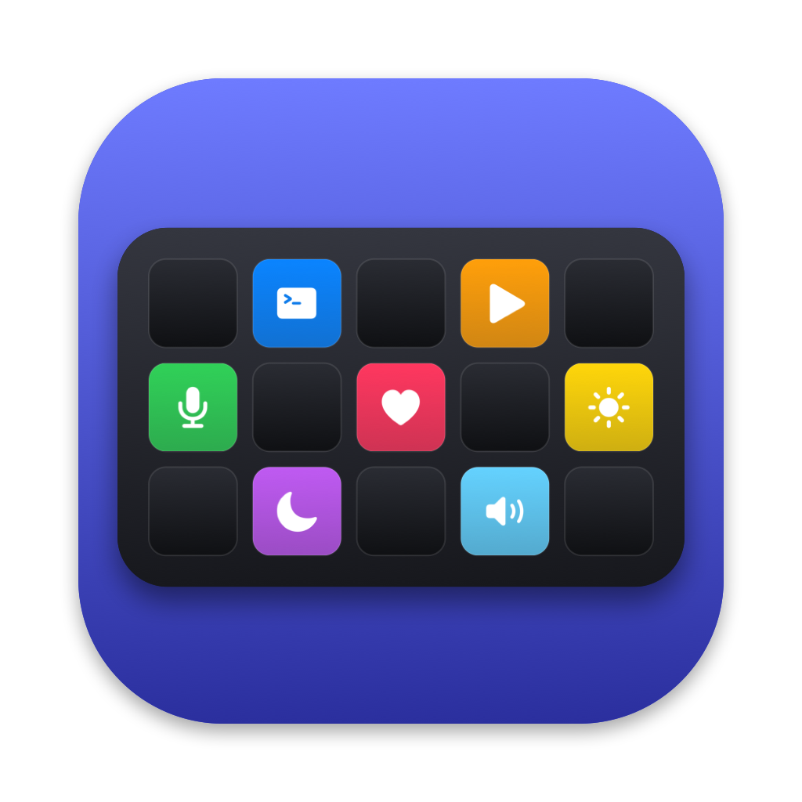

# StreamDeck

A macOS menu-bar app that drives an Elgato Stream Deck over USB, without Elgato's software. Keys, pages and actions come from a YAML file that reloads when you save it. On Linux, for example a Steam Machine running SteamOS, a headless daemon, `streamdeckd`, does the same with the same config: see [Steam Machine (Linux)](#steam-machine-linux).

Supported hardware: **Stream Deck Original V2** (15 keys, USB product ID `0x006d`). Other models are ignored.

## Requirements

- macOS 14 or later
- Xcode command line tools with Swift 6 (`swift --version`)
- An Apple Development signing identity in your keychain. Check with `security find-identity -v -p codesigning`. The app needs a stable signature, otherwise macOS forgets its Accessibility permission after every rebuild.

## Build

```sh
./scripts/bundle.sh
```

This builds a release binary and writes a signed `build/StreamDeck.app`. To pick a different identity:

```sh
SIGN_IDENTITY="Apple Development: Your Name (TEAMID)" ./scripts/bundle.sh
```

The app icon is generated. After editing `scripts/make-icon.swift`, regenerate it with:

```sh
./scripts/make-icon.sh
```

Run the tests with:

```sh
swift test
```

### Linux

Everything except the macOS app builds and tests on Linux, including `streamdeckd` and its platform code. Run the tests in Docker, without installing Swift:

```sh
./scripts/test-linux.sh
```

Arguments go to `swift`, for example `./scripts/test-linux.sh test --filter DeckEngineTests`. Build products go to `~/.cache/streamdeck-linux-build`, not `.build`. `SWIFT_VERSION` picks another image. With a native Swift toolchain on Linux, plain `swift test` works the same.

The web editor's JavaScript has its own tests, run with Node in Docker: `./scripts/test-web.sh`. To try the web editor without a deck (pairing needs one), `./scripts/dev-web-token.sh` adds a paired browser with a known token. Set the cookie it prints in the browser's devtools. `./scripts/test-web-e2e.sh` runs the browser checks in headless Chromium and Firefox against `build/linux/streamdeckd`. Build it first with `./scripts/build-linux.sh`.

## Steam Machine (Linux)

`streamdeckd` drives the deck headless on Linux: no window, no tray icon. It is built for a Steam Machine in SteamOS Game Mode, but runs on any x86_64 Linux with systemd. It reads the same `~/.config/streamdeck/config.yaml` and reloads it when you save. On Linux, `cmd` is the Super key, `fn` does nothing, and `open: steam://rungameid/<AppID>` launches a game; see [docs/config.md](docs/config.md#linux).

**Build** a single static binary (in Docker, on any Linux machine with Docker):

```sh
./scripts/build-linux.sh        # -> build/linux/streamdeckd
```

**Copy** it to the Steam Machine together with the service files and the install script. On SteamOS, first open a terminal in desktop mode, give the `deck` user a password with `passwd` (SSH and `sudo` need one), and enable SSH with `sudo systemctl enable --now sshd`.

```sh
scp build/linux/streamdeckd dist/linux/* scripts/install-linux.sh deck@steammachine:
```

**Install** on the Steam Machine, as `deck` (not root). It asks for the sudo password once, for the udev rules:

```sh
ssh -t deck@steammachine ./install-linux.sh
```

This puts the binary in `~/.local/bin`, installs and starts a systemd user service that runs at login and restarts after a crash, and installs udev rules in `/etc/udev/rules.d` that give the logged-in user access to the deck and to `/dev/uinput` (for `keys` and `media`). SteamOS keeps `/etc` and your home directory across system updates. Run the same command again to upgrade.

**Configure** in a browser with the [web editor](#web-editor), or over SSH: edit `~/.config/streamdeck/config.yaml`. The first start creates a starter config with Steam and media keys. Watch what the daemon does:

```sh
ssh deck@steammachine journalctl --user -u streamdeckd -f
```

Problems also show on the deck. A key whose action, icon or dynamic command failed gets a red dot. A problem that belongs to no key, such as a config error or missing access to `/dev/uinput`, turns the bottom-right key (14) into a red status key; press it to log every current problem to the journal. It returns to normal when the problem is fixed.

**Uninstall**: `./install-linux.sh --uninstall`. Your config stays.

### Web editor

`streamdeckd` serves a config editor to browsers on your network, on port 3325. The journal shows its address at startup, for example `web editor at http://steammachine.local:3325/` and the same for each IP address. Open it on a laptop or phone. It edits the same things as the Mac editor: keys, pages and settings, with validation, Save and Revert. The deck previews your changes while the editor is open, and the key grid shows exactly what the deck shows. While the editor tab is in front, the deck shows the page you selected, and pressing a deck key selects it in the editor instead of running it. A minute after the last editor tab closes, the deck goes back to the saved config. Unsaved changes stay in the daemon until it restarts, so a reload or a locked phone doesn't lose them.

**Pairing.** A config can run shell commands, so only paired browsers get in. The first time, click **Show a code on the deck**. The deck shows a 6-digit code and a Cancel key. Type the code in the browser. The code expires after 2 minutes. After 5 wrong tries it stops working, and after 10 wrong tries in 10 minutes pairing is locked for 10 minutes. A paired browser stays paired until revoked: **Settings → Paired browsers** lists them and revokes any of them. To revoke all, delete `~/.local/state/streamdeck/web-clients.json` (it stores only hashes of the tokens) and restart the service.

**Images and icons** are entered as paths on the Steam Machine, relative to `~/.config/streamdeck/`. The editor can't upload files; copy them with `scp`. Material Symbols have a searchable picker.

**Recording keystrokes.** Click the Keys field and press the combination. The Meta/Windows key records as `cmd` (Super on Linux). Shortcuts the browser keeps for itself, such as Ctrl-W or Ctrl-T, and `fn` can't be recorded: use **Edit as text**.

**Security.** The editor uses plain HTTP: anyone on the same network who can watch its traffic can read the config and the browser's token. Use it on a network you trust. Requests from other websites are refused, even in a paired browser.

**Options.** `--web-listen <address>:<port>` changes where it listens, for example `127.0.0.1:3325` for SSH tunnels only. `--no-web` turns it off. To set them, override the service's command:

```sh
systemctl --user edit streamdeckd
# [Service]
# ExecStart=
# ExecStart=%h/.local/bin/streamdeckd --no-web
systemctl --user restart streamdeckd
```

If the port is taken, the deck keeps working, the journal says why, and the status key shows `Web`.

## Install

1. **Quit the Elgato Stream Deck app** and remove it from login items. Only one app can drive the deck at a time. If Elgato's app is running, the menu says so.
2. Copy the app to `/Applications`:
   ```sh
   cp -R build/StreamDeck.app /Applications/
   open /Applications/StreamDeck.app
   ```
   A grid icon appears in the menu bar. There is no Dock icon, except while the config editor is open.
3. Optional: choose **Launch at Login** in the menu.

Always run the copy in `/Applications`. macOS ties permissions and the login item to the app's path and signature.

## Accessibility permission

Keys that send keystrokes (`keys:`) or media keys (`media:`) need Accessibility permission. The first time you press one, the menu shows the problem and offers **Open Accessibility Settings…**. Enable **StreamDeck** there and press the key again.

Shell commands, opening apps or URLs, and page switching work without it. Input Monitoring permission is not needed.

## Configure

The config lives at `~/.config/streamdeck/config.yaml`. The first launch creates a starter config.

**Edit Config…** in the menu opens the config editor: a grid of the deck's keys, the pages, and the settings. Changes show on the deck as you make them and are written to the file when you save. Saving from the editor rewrites the file in a fixed format and drops comments. The first time it overwrites a hand-edited file, it asks and keeps the old file as `config.yaml.bak`. See [docs/config.md](docs/config.md#config-editor).

**Open Config** opens the YAML file in a text editor instead:

```yaml
default_page: home
pages:
  home:
    keys:
      0: { icon: sf:terminal, label: Terminal, action: { open: /System/Applications/Utilities/Terminal.app } }
      1: { icon: ms:mic_off, action: { keys: cmd+shift+m } }
      14: { dynamic: { run: "date +%H:%M", every: 30s } }
```

Icons are Material Symbols (`ms:mic_off`, `ms:lightbulb.fill`), which look the same on every platform, SF Symbols (`sf:terminal`, macOS only) or image files. See [docs/config.md](docs/config.md) for every field, action and option.

### Dynamic keys

A dynamic key runs a shell command on a schedule and shows its output. Plain text replaces the label. JSON can also set the icon and background:

```yaml
3: { icon: sf:bitcoinsign.circle, dynamic: { run: ~/.config/streamdeck/btc.sh, every: 1m } }
```

```sh
#!/bin/sh
# ~/.config/streamdeck/btc.sh: bitcoin price, red background below 60000
price=$(curl -sf https://api.coinbase.com/v2/prices/BTC-USD/spot | jq -r '.data.amount | tonumber | floor') || exit 1
if [ "$price" -lt 60000 ]; then color="#802020"; else color="#205020"; fi
echo "{\"label\":\"$price\",\"background\":\"$color\"}"
```

Fields the script leaves out keep the key's configured value. A command that fails, times out or prints invalid JSON keeps the last appearance and shows a red dot. See [docs/config.md](docs/config.md#dynamic-keys) for the full format and a Home Assistant example.

## Troubleshooting

| Symptom | Check |
|---|---|
| Menu says "Not connected" | Is the deck plugged in directly? Is the Elgato app quit? |
| Keys stay dark after a config edit | The menu lists config errors with line numbers. The deck keeps the last valid config. |
| Linux: the deck stays dark | `journalctl --user -u streamdeckd`. "permission denied" for `/dev/hidraw…` means the udev rules are missing: run `install-linux.sh` again. |
| Linux: the web editor doesn't open | The journal's `web editor at` lines show the addresses. `.local` names need mDNS on the network; use the IP address. A status key labeled `Web` means the port is taken: see `--web-listen`. |
| Linux: keystroke keys do nothing | The status key says `Keys` and the journal names `/dev/uinput`: run `install-linux.sh` again. A wrong character on a non-US keyboard: the journal's `keyboard layout` line at startup shows which layout was detected. |
| Keystroke keys do nothing | Accessibility permission (see above). After a rebuild signed with a different identity, remove and re-add StreamDeck in Accessibility settings. |
| A shell command works in Terminal but not on the deck | Commands run in your login shell (`$SHELL -l -c`), so PATH comes from your shell profile, not from interactive-only files such as `.zshrc`. |

## Project layout

| Path | Contents |
|---|---|
| `Sources/DeckHID` | Stream Deck report codec and the transport interface ([docs/protocol.md](docs/protocol.md)) |
| `Sources/DeckConfig` | YAML parsing, validation, file watching (FSEvents on macOS, inotify on Linux), the editable document and its writer |
| `Sources/DeckEngine` | Pages, actions, dynamic keys, shell commands; the interfaces for transport, rendering and actions |
| `Sources/DeckSupport` | Small helpers shared by the portable targets, such as a lock |
| `Sources/DeckEditor` | The editor's draft, validation, page operations, save with backup and external changes, without UI, and its JSON format. Used by the web editor |
| `Sources/DeckWeb` | The web editor's HTTP server (Hummingbird): API, server-sent events, pairing, paired-browser tokens |
| `Sources/CWebAssets` | The web editor's HTML, CSS and JavaScript (`web/`), compiled into the binary with `#embed` |
| `Sources/DeckRender` | Key image rendering for the deck and the editor previews, the same on every platform: layout, labels, Material Symbols, PNG/JPEG |
| `Sources/CStb` | Vendored stb libraries (TrueType, PNG/JPEG decoding, JPEG encoding) and the embedded fonts ([README](Sources/CStb/README.md); fonts regenerated by `scripts/make-fonts.sh`) |
| `Sources/DeckPlatformMac` | IOKit HID transport, keystroke and media key actions, keyboard layout, SF Symbols. macOS only |
| `Sources/StreamDeckApp` | Menu-bar app and config editor window. macOS only |
| `Sources/DeckPlatformLinux` | hidraw transport, uinput keyboard, XKB layout, `steam`/`xdg-open`, resume detection, journal lines. Linux only |
| `Sources/CLinux` | C wrappers for the hidraw and uinput ioctls, and the kernel input constants. Linux only |
| `Sources/streamdeckd` | The headless Linux daemon. Linux only |
| `dist/linux/` | systemd user unit, udev rules and uinput module file, installed by `scripts/install-linux.sh` |
| `Resources/` | App icon (generated by `scripts/make-icon.sh`) |
| `openspec/` | Specs and change history |

## License

MIT. See [LICENSE](LICENSE).

Bundled third-party code and fonts keep their own licenses: [stb](https://github.com/nothings/stb) (public domain or MIT), [Inter](https://github.com/rsms/inter) (SIL Open Font License 1.1) and [Material Symbols](https://github.com/google/material-design-icons) (Apache-2.0). The license files are in `Sources/CStb/`.
