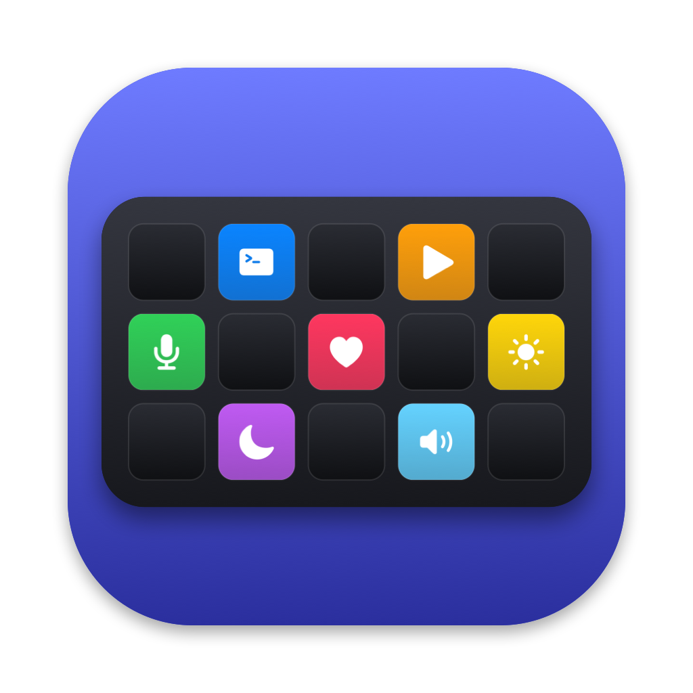

# StreamDeck

A macOS menu-bar app that drives an Elgato Stream Deck over USB, without Elgato's software. Keys, pages and actions come from a YAML file that reloads when you save it.

Supported hardware: **Stream Deck Original V2** (15 keys, USB product ID `0x006d`). Other models are ignored.

## Requirements

- macOS 14 or later
- Xcode command line tools with Swift 6 (`swift --version`)
- An Apple Development signing identity in your keychain. Check with `security find-identity -v -p codesigning`. The app needs a stable signature, otherwise macOS forgets its Accessibility permission after every rebuild.

## Build

```sh
./scripts/bundle.sh
```

This builds a release binary and writes a signed `build/StreamDeck.app`. To pick a different identity:

```sh
SIGN_IDENTITY="Apple Development: Your Name (TEAMID)" ./scripts/bundle.sh
```

The app icon is generated. After editing `scripts/make-icon.swift`, regenerate it with:

```sh
./scripts/make-icon.sh
```

Run the tests with:

```sh
swift test
```

## Install

1. **Quit the Elgato Stream Deck app** and remove it from login items. Only one app can drive the deck at a time. If Elgato's app is running, the menu says so.
2. Copy the app to `/Applications`:
   ```sh
   cp -R build/StreamDeck.app /Applications/
   open /Applications/StreamDeck.app
   ```
   A grid icon appears in the menu bar. There is no Dock icon, except while the config editor is open.
3. Optional: choose **Launch at Login** in the menu.

Always run the copy in `/Applications`. macOS ties permissions and the login item to the app's path and signature.

## Accessibility permission

Keys that send keystrokes (`keys:`) or media keys (`media:`) need Accessibility permission. The first time you press one, the menu shows the problem and offers **Open Accessibility Settings…**. Enable **StreamDeck** there and press the key again.

Shell commands, opening apps or URLs, and page switching work without it. Input Monitoring permission is not needed.

## Configure

The config lives at `~/.config/streamdeck/config.yaml`. The first launch creates a starter config.

**Edit Config…** in the menu opens the config editor: a grid of the deck's keys, the pages, and the settings. Changes show on the deck as you make them and are written to the file when you save. Saving from the editor rewrites the file in a fixed format and drops comments. The first time it overwrites a hand-edited file, it asks and keeps the old file as `config.yaml.bak`. See [docs/config.md](docs/config.md#config-editor).

**Open Config** opens the YAML file in a text editor instead:

```yaml
default_page: home
pages:
  home:
    keys:
      0: { icon: sf:terminal, label: Terminal, action: { open: /System/Applications/Utilities/Terminal.app } }
      1: { icon: sf:mic.slash.fill, action: { keys: cmd+shift+m } }
      14: { dynamic: { run: "date +%H:%M", every: 30s } }
```

See [docs/config.md](docs/config.md) for every field, action and option.

### Dynamic keys

A dynamic key runs a shell command on a schedule and shows its output. Plain text replaces the label. JSON can also set the icon and background:

```yaml
3: { icon: sf:bitcoinsign.circle, dynamic: { run: ~/.config/streamdeck/btc.sh, every: 1m } }
```

```sh
#!/bin/sh
# ~/.config/streamdeck/btc.sh: bitcoin price, red background below 60000
price=$(curl -sf https://api.coinbase.com/v2/prices/BTC-USD/spot | jq -r '.data.amount | tonumber | floor') || exit 1
if [ "$price" -lt 60000 ]; then color="#802020"; else color="#205020"; fi
echo "{\"label\":\"$price\",\"background\":\"$color\"}"
```

Fields the script leaves out keep the key's configured value. A command that fails, times out or prints invalid JSON keeps the last appearance and shows a red dot. See [docs/config.md](docs/config.md#dynamic-keys) for the full format and a Home Assistant example.

## Troubleshooting

| Symptom | Check |
|---|---|
| Menu says "Not connected" | Is the deck plugged in directly? Is the Elgato app quit? |
| Keys stay dark after a config edit | The menu lists config errors with line numbers. The deck keeps the last valid config. |
| Keystroke keys do nothing | Accessibility permission (see above). After a rebuild signed with a different identity, remove and re-add StreamDeck in Accessibility settings. |
| A shell command works in Terminal but not on the deck | Commands run in your login shell (`$SHELL -l -c`), so PATH comes from your shell profile, not from interactive-only files such as `.zshrc`. |

## Project layout

| Path | Contents |
|---|---|
| `Sources/DeckHID` | USB HID transport and report codec ([docs/protocol.md](docs/protocol.md)) |
| `Sources/DeckConfig` | YAML parsing, validation, file watching, the editable document and its writer |
| `Sources/DeckRender` | Key image rendering |
| `Sources/DeckEngine` | Pages, actions, dynamic keys |
| `Sources/StreamDeckApp` | Menu-bar app and config editor window |
| `Resources/` | App icon (generated by `scripts/make-icon.sh`) |
| `openspec/` | Specs and change history |

## License

MIT. See [LICENSE](LICENSE).
